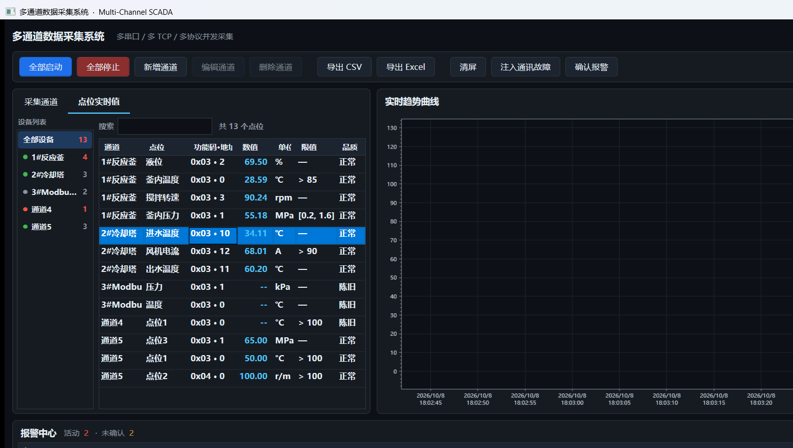
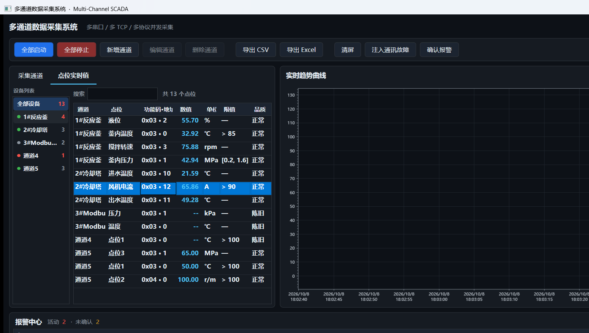
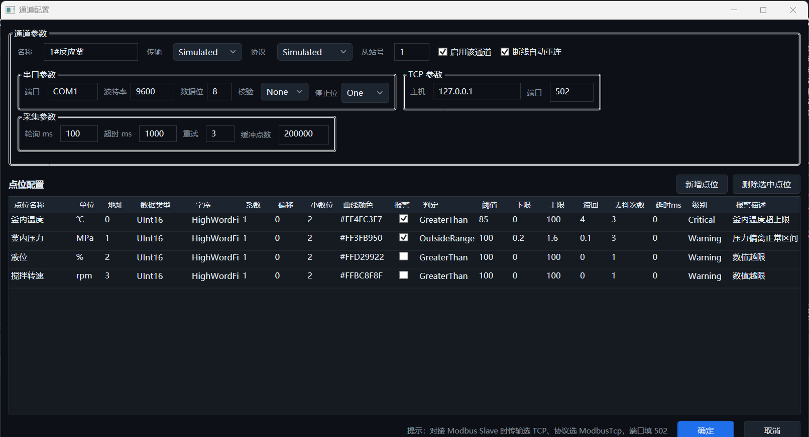

# 多通道数据采集系统 · Multi-Channel SCADA

一个用 **WPF + .NET 10** 写的上位机数据采集平台：多串口 / 多 TCP 设备 / 多通讯协议**同时**采集，实时多曲线看板、历史数据导出、报警三重抑制与多渠道推送。

没有硬件也能跑 —— 内置模拟器开箱即用，也可以直接对接 **Modbus Slave** / com0com 虚拟串口做真实链路联调（见 [docs/modbus-slave-guide.md](docs/modbus-slave-guide.md)）。



选中某台设备后，点位表只显示该设备点位，通道列自动折叠：



---

## 1. 它解决什么问题

工业现场的数据采集上位机，难点从来不是"把寄存器读出来"，而是这几件事：

| 现场真实痛点 | 本项目对应的做法 |
| --- | --- |
| 十几台设备、串口和网口混合，协议还不一样 | 传输（SerialPort / Tcp / Simulated）× 协议（ModbusRtu / ModbusTcp / AsciiLine / Simulated）自由组合，每个通道一条独立长跑任务 |
| 采集线程和 UI 线程互相拖死 | 采集侧只往有界管道里投递，UI 线程 30fps 单独取数渲染，两边完全解耦 |
| 跑一整天内存越用越多、界面越用越卡 | 预分配定长环形缓冲 + 峰值保留降采样，稳态下运行期**零堆分配** |
| 一个尖峰过去就报警、抖一下就恢复，报警刷屏 | 去抖次数 + 延时确认 + 滞回阈值三重抑制 |
| 报警响过就没人知道了 | 日志 / 声音 / Webhook 三渠道并行推送，单渠道失败不影响采集 |
| 现场没人值守，程序崩了就全丢 | 全局异常兜底落盘 + 断线指数退避自动重连 |

---

## 2. 功能一览

**采集**
- 多通道并发：串口 / TCP / 内置模拟器任意混合，通道之间互不阻塞
- 协议：Modbus RTU（CRC16 + 脏数据滑动重同步）、Modbus TCP（MBAP）、自定义 ASCII 行协议
- **四种读功能码按点位配置**：0x01 线圈 / 0x02 离散输入（位值，解析成 1 / 0）/ 0x03 保持寄存器 / 0x04 输入寄存器
- 点位级数据类型：UInt16 / Int16 / UInt32 / Int32 / Float32，支持高/低字序
- 工程量线性变换：`工程值 = 原始值 × 系数 + 偏移`，可配置小数位
- 断线自动重连（指数退避 1s → 30s）、失败重试、轮询周期可调

**展示**
- ScottPlot 5 `SignalXY` 渲染，时间轴自动按跨度切换刻度粒度
- Y 轴自动缩放**降频**处理（每 15 帧一次），避免曲线上下抖动
- 通道状态 / 点位实时值 / 报警列表三块联动，状态区 1Hz 刷新
- **按设备查看点位**：「点位实时值」页左侧是设备列表（含状态灯、点位数、活动报警角标），
  选中某台设备后右侧只显示它的点位，通道列自动折叠；可再按点位名 / 地址做关键字过滤
- 曲线可勾选「只看当前设备」，跟随左侧选择只画该设备的趋势，标题上标明当前是哪台设备

**报警**
- 判定：大于 / 小于 / 区间外 / 区间内，级别 提示 / 警告 / 严重
- 抑制：去抖次数、延时确认、滞回阈值
- 推送：日志文件（按天切分）、声音（严重级别蜂鸣）、Webhook（企业微信 / 钉钉机器人）

**导出**
- CSV：长表流式写出（时间 / 通道 / 点位 / 数值 / 单位），几十万行不占内存，带 UTF-8 BOM
- Excel：ClosedXML，每个点位一个 Sheet + 一张总览表，**不需要装 Office**

**工程化**
- 配置持久化到 `config/channels.json`，重启自动恢复
- `tools/SelfCheck` 控制台自检：**44 项断言** 覆盖编解码、报警抑制、环形缓冲、端到端采集、导出、配置往返
- 自检里含一段 **真实 socket 的 Modbus TCP 端到端测试**（内嵌迷你从站，精确断言解析出的寄存器值）—— 不用装 Modbus Slave，也能保证 TCP 链路本身是通的

---

## 3. 技术亮点（面试可以展开讲的部分）

### 3.1 背压：有界管道 + 单消费者

采集线程只管投递，不碰任何共享状态：

```csharp
_pipeline = Channel.CreateBounded<SampleEnvelope>(new BoundedChannelOptions(100_000)
{
    FullMode    = BoundedChannelFullMode.DropOldest,  // 消费不过来时丢最老的，而不是阻塞采集
    SingleReader = true                               // 只有汇聚线程一个读者 → 可以走无锁快路径
});
```

汇聚线程按 **512 条一批** 批量写入环形缓冲。批量写入的意义是：把"每条数据的固定开销"摊薄成"每 512 条的固定开销"，20 个通道满载时也几乎没有额外开销。

### 3.2 环形缓冲：稳态零分配

`TimeSeriesBuffer` 预分配定长数组，`Append` 只移动写指针、不 new 对象。UI 侧再配一块独立的 8192 点复用数组，取数时直接往这块内存里拷 —— 曲线以 30fps 刷新时，**每帧不产生任何需要 GC 的垃圾**。这是"跑一整天不掉帧"的根本原因。

### 3.3 降采样：峰值保留

抽稀最怕把尖峰抽掉——一个 2ms 的毛刺往往正是要找的故障特征。所以不用等间隔抽样，而是**峰值保留**：

```
[桶]  每桶取 min 和 max 两个点输出
```

超过 1600 点才启动降采样，屏幕像素本来也画不出更多点，但尖峰一定保留。

### 3.4 报警三重抑制

```
第 1 层 去抖次数 DebounceCount ：连续 N 次超限才算数（滤掉单点毛刺）
第 2 层 延时确认 DelayMs       ：超限持续一段时间才上报（滤掉短时工况波动）
第 3 层 滞回  Hysteresis      ：恢复阈值比触发阈值宽松（滤掉临界值反复横跳）
```

### 3.5 分层与依赖倒置

`Core` 层**零 UI 依赖、零硬件包依赖**：它只定义 `ITransport` / `IProtocolCodec` / `IDeviceDriver` / `IAlarmNotifier` / `IDataExporter` 这些抽象，具体实现全在 `Infrastructure`。换一个协议、换一个通知渠道，`Core` 一行都不用改。

`IDeviceDriverFactory` 按"传输 × 协议"组合出驱动，接一台新设备本质上是**加配置而不是加代码**。

### 3.6 两个容易踩的坑（已修）

- **ScottPlot 数据源必须传"长度恰好等于点数"的数组**。把复用的 8192 大数组直接丢进去，尾部未初始化的 0 会破坏"X 必须递增"的前提，曲线直接不显示。所以每帧只 new 精确长度的数组。
- **NuGet 平台版本决定选到哪个资源**。项目原本写 `net10.0-windows`，平台版本默认是 7.0，而 `SkiaSharp.Views.WPF` 只提供 `net8.0-windows10.0.19041` 资源 —— 7.0 不满足兼容规则，NuGet 会**退回 net462 程序集**并报 NU1701，靠 .NET 兼容层跑起来。改成 `net10.0-windows10.0.19041.0` 才是真的用上了对的程序集。

---

## 4. 架构

```
┌──────────────────────────────────────────────────────────────┐
│  WpfApp22.App            表现层（MVVM）                       │
│  MainWindow / ChannelEditorWindow                            │
│  MainViewModel ── 双节拍：曲线 30fps ／ 状态 1Hz              │
│  IChartHost ← MainWindow（ScottPlot 只在这里出现）            │
└───────────────────────────┬──────────────────────────────────┘
                            │ 只依赖抽象
┌───────────────────────────▼──────────────────────────────────┐
│  WpfApp22.Core           核心抽象层（net10.0，零第三方包）     │
│  Models        ChannelConfig / PointDefinition / Sample / Alarm│
│  Abstractions  ITransport / IProtocolCodec / IDeviceDriver     │
│                IDeviceDriverFactory / IAlarmNotifier           │
│                IDataExporter                                   │
│  Buffers       TimeSeriesBuffer（环形）／ Downsampler（峰值）  │
│  Services      AcquisitionService（并发中枢）                  │
│                DataHub / SeriesStore / ChannelRuntime          │
│                AlarmEngine（三重抑制）                         │
└───────────────────────────▲──────────────────────────────────┘
                            │ 实现抽象
┌───────────────────────────┴──────────────────────────────────┐
│  WpfApp22.Infrastructure  基础设施层                          │
│  Transports  SerialPortTransport / TcpTransport               │
│  Protocols   ModbusRtuCodec / ModbusTcpCodec / AsciiLineCodec │
│  Drivers     ModbusDriver / SimulatedDriver / Factory          │
│  Simulation  SimulationController（故障注入）                  │
│  Export      CsvExporter / ExcelExporter / ExportService       │
│  Notify      LogNotifier / SoundNotifier / WebhookNotifier     │
│              AlarmDispatcher / NotifyOptions                   │
└──────────────────────────────────────────────────────────────┘
┌──────────────────────────────────────────────────────────────┐
│  tools/SelfCheck          控制台自检，44 项断言                │
└──────────────────────────────────────────────────────────────┘
```

### 数据流

```
每通道一个 Task ──┐
   PeriodicTimer  │  读寄存器 → 解码 → 工程量变换 → AlarmEngine
   轮询 + 重试     │
                  ▼
        Channel<SampleEnvelope>  ── 有界队列（10 万，满了丢最老）· 背压
                  │
                  ▼  单消费者，512 条一批
        DataHub ──► SeriesStore × N ──► TimeSeriesBuffer（定长环形，零分配）
                  │
      ┌───────────┴────────────┐
      ▼ 30fps                 ▼ 导出时
  峰值降采样→1600 点        CSV / Excel
      ▼
  ScottPlot SignalXY
```

---

## 5. 目录结构

```
WpfApp22.slnx
├── WpfApp22.Core/                     # 核心抽象层（无 UI、无硬件包）
│   ├── Models/                        # Enums, ChannelConfig, PointDefinition, Sample, Alarm
│   ├── Abstractions/                  # ITransport, IProtocolCodec, IDeviceDriver, ...
│   ├── Buffers/                       # TimeSeriesBuffer, Downsampler
│   └── Services/                      # AcquisitionService, DataHub, SeriesStore,
│                                      # ChannelRuntime, AlarmEngine
├── WpfApp22.Infrastructure/           # 传输 / 协议 / 驱动 / 导出 / 通知
│   ├── Transports/  Protocols/  Drivers/  Simulation/
│   ├── Export/                        # CsvExporter, ExcelExporter, ExportService
│   ├── Notify/                        # LogNotifier, SoundNotifier, WebhookNotifier
│   └── DependencyInjection.cs         # AddAcquisitionPlatform()
├── WpfApp22.App/                      # WPF 表现层
│   ├── ViewModels/                    # MainViewModel, ChannelRow, PointRow
│   ├── Themes/Styles.xaml             # 深色工业主题
│   ├── MainWindow.xaml(.cs)           # 主界面 + 图表宿主（IChartHost）
│   └── ChannelEditorWindow.xaml(.cs)  # 通道 / 点位配置
├── tools/SelfCheck/                   # 控制台自检（44 项断言）
└── docs/
```

---

## 6. 快速开始

**环境**：.NET SDK 10.0+（本仓库用 10.0.401 验证）、Windows 10 1809 (build 17763) 及以上

```bash
# 编译
dotnet build WpfApp22.slnx

# 跑自检（不需要界面，65 项断言）
dotnet run --project tools/SelfCheck/SelfCheck.csproj

# 启动上位机
dotnet run --project WpfApp22.App
```

启动后点工具栏 **「全部启动」**，1#反应釜（100ms 轮询）和 2#冷却塔（200ms）两个内置模拟通道立刻开始跑，曲线、实时值、报警都会动起来。

通道多的时候不用在平铺的全量点位表里找：切到 **「点位实时值」** 页，左侧设备列表里点一台设备，
右侧就只剩这台设备的点位（通道列会自动折叠），再配右上角的搜索框可以按点位名或地址继续缩小范围。

```bash
dotnet run --project WpfApp22.App -- --autostart
```

> 默认**不**自动采集是刻意的：程序一打开就往串口/网口发请求，而现场设备往往还没上电，只会刷一屏通讯错误。

### 想看点"故障"的样子

工具栏点 **「注入通讯故障」**，模拟器会随机丢包/返回异常码，可以看到：
- 通道状态变为「通讯故障」，自动重连开始指数退避
- 曲线出现断点（NaN 被剔除，不会画成 0）
- 上方报警中心出现通讯类报警

点「全部启动」旁边的按钮可以关掉故障注入。

### 导出

先跑一会儿积累数据，点 **「导出 CSV」** 或 **「导出 Excel」**。CSV 是长表（时间 / 通道 / 点位 / 数值 / 单位），Excel 是每个点位一个 Sheet。

---

## 7. 对接真实设备

### 7.1 内置模拟器（默认，零依赖）

首次运行生成两个模拟通道，曲线形态是"正弦 + 噪声 + 偶发尖峰"，并且会周期性越过报警阈值，用来演示报警链路。

### 7.2 Modbus Slave（推荐用来演示"真实 Modbus 链路"）

不需要任何硬件，也不需要虚拟串口 —— **Modbus Slave 直接监听 TCP 502，上位机作为主站连它**。

配置窗口是这样的：



完整的两种玩法（TCP 直连 / com0com 虚拟串口 RTU）见 **[docs/modbus-slave-guide.md](docs/modbus-slave-guide.md)**。

### 7.3 真实 PLC / 仪表

在「通道配置」里把传输、协议、IP/串口参数、从站号、寄存器地址按设备手册填好即可。要点：
- 手册上的地址若是 `40001` 这种 1-based 表示，填进本项目要 **减 1**（Modbus 协议本身是 0-based）
- 32 位数据（Float32 / Int32）要确认设备的**字序**，填错会得到一个看似合理但完全不对的数

---

## 8. 配置说明

### config/channels.json

首次运行自动生成，界面上的增删改都会写回。字段含义：

```jsonc
{
  "Name": "3#Modbus TCP",
  "Enabled": true,                              // 是否参与「全部启动」
  "Transport": "Tcp",                           // SerialPort | Tcp | Simulated
  "Protocol": "ModbusTcp",                      // ModbusRtu | ModbusTcp | AsciiLine | Simulated
  "Host": "127.0.0.1",
  "Port": 502,
  "SlaveId": 1,
  "PollIntervalMs": 500,                        // 轮询周期 = 采集频率的直接来源
  "TimeoutMs": 1000,
  "RetryCount": 3,
  "AutoReconnect": true,
  "BufferCapacity": 200000,                     // 环形缓冲容量（每点位历史点数）
  "Points": [
    {
      "Name": "温度", "Unit": "℃",
      "RegisterAddress": 0,
      "DataType": "UInt16",                     // UInt16|Int16|UInt32|Int32|Float32
      "RegisterKind": "HoldingRegister",        // 决定用哪个功能码读，必须与从站一致：
                                                //   Coil→0x01 线圈（位）| DiscreteInput→0x02 离散输入（位）
                                                //   HoldingRegister→0x03 保持寄存器 | InputRegister→0x04 输入寄存器
      "WordOrder": "HighWordFirst",
      "Scale": 0.1, "Offset": 0, "DecimalPlaces": 1,
      "Color": "#FF4FC3F7",
      "VisibleOnChart": true,
      "Alarm": {
        "Enabled": true, "Operator": "GreaterThan",
        "Threshold": 85, "Severity": "Critical",
        "Hysteresis": 4, "DebounceCount": 3, "DelayMs": 0,
        "Message": "温度超上限"
      }
    }
  ]
}
```

### config/notify.json

```jsonc
{
  "SoundEnabled": true,
  "SoundOnlyForCritical": true,
  "WebhookUrl": ""          // 留空则 Webhook 渠道自动禁用
}
```

填上企业微信 / 钉钉群机器人地址即可收到报警推送（消息体用的就是两者通用的 `text` 格式）。现场改地址也可以直接用环境变量覆盖，不用改配置文件：

```bash
set WPFAPP22_WEBHOOK_URL=https://qyapi.weixin.qq.com/cgi-bin/webhook/send?key=xxx
```

> 界面报警中心右上角显示的"通知渠道"是**实际生效**的渠道列表 —— Webhook 没配地址就不会出现，避免界面上写着却一条都发不出去。

### 运行期产物

| 路径 | 内容 |
| --- | --- |
| `config/channels.json` | 通道与点位配置 |
| `config/notify.json` | 报警推送配置 |
| `logs/alarm-YYYYMMDD.log` | 报警记录，按天切分 |
| `logs/crash-YYYYMMDD.log` | 未捕获异常兜底日志 |

（以上路径均相对于程序运行目录 `bin/.../`）

---

## 9. 自检

```bash
dotnet run --project tools/SelfCheck/SelfCheck.csproj
```

```
[1]  Modbus RTU 编解码             16 项   含 CRC 校验、脏数据重同步、0x01/0x02 位解析
[2]  Modbus TCP 编解码              13 项   含 MBAP 长度字段、半包不误判、0x01/0x02 位解析
[3]  ASCII 行协议                   1 项
[4]  寄存器解码与功能码映射         11 项   含 Float32 高低字序、Int16/UInt16、四种功能码映射
[5]  报警引擎：去抖与滞回           6 项
[6]  环形缓冲                       5 项   含覆盖行为、取最新/取最老
[7]  端到端采集（内置模拟器）       4 项
[8]  导出 CSV / Excel               3 项
[9]  配置序列化往返                 1 项
[10] 端到端采集（真实 Modbus TCP）  4 项   内嵌迷你从站，真实 socket 往返，精确断言寄存器值
[11] 功能码不匹配不断线             4 项   从站回异常帧时链路保持运行，改对功能码后立刻出数

结果：通过 65，失败 0
```

自检刻意不依赖界面和硬件 —— 它验证的是"协议解析对不对""报警抑制逻辑对不对"这类**纯逻辑**，可以放进 CI。
第 [10] 组虽然用了 socket，但监听在回环地址的随机空闲端口上，不需要任何外部设备或软件。

---

## 10. 已知取舍

- **单进程内采集**。真要做多机集中监控，下一步是把 `DataHub` 换成把数据推给时序库（InfluxDB / TDengine），UI 改成读库。
- **ScottPlot 图例画在最上层**，曲线密集时会挡住右上角一小块数据；可以改成把图例放到图外（`plot.ShowLegend(Alignment.OutsideUpperRight)`）。
- **报警只用阈值**，没有做变化率（Rate-of-Change）和工况联锁。
- **Webhook 是单向推送**，没有做重试队列；现场断网时的补偿交给日志渠道兜底。
- 声音报警用 `Console.Beep`，只有 Windows 平台有；跨平台时需要换成播放音频文件。

---

## 11. 第三方依赖

| 包 | 用途 |
| --- | --- |
| ScottPlot.WPF 5.1.59 | 高性能多曲线渲染（`SignalXY` 按像素聚合） |
| CommunityToolkit.Mvvm 8.4.2 | MVVM 源生成器（`ObservableProperty` / `RelayCommand`） |
| Microsoft.Extensions.DependencyInjection 10.0.12 | 依赖注入 |
| ClosedXML 0.105.1 | Excel 导出（无需安装 Office） |
| System.IO.Ports 10.0.12 | 串口（仅 Infrastructure 层引用） |
